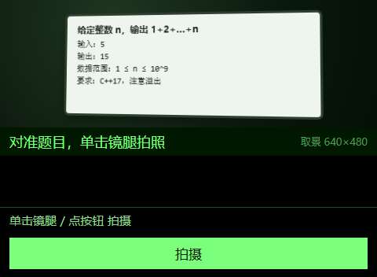
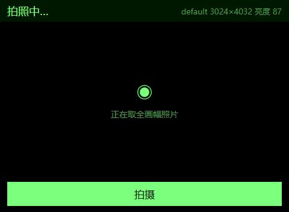
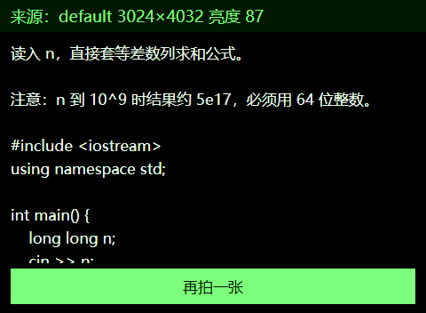

# rokid-glasses-coding-problem-agent

**一句话：戴在乐奇（Rokid）眼镜上的编程题智能体——单击镜腿拍下题目，主机侧大模型作答并用 g++ 真编译、跑用例，答案回到眼镜屏幕上。**

不是“让模型口头自检”，而是主机真的把模型写的 C++ 编译一遍、跑几组用例，通过了才把最终版发回眼镜。

---

## 一、复刻必须准备什么

### 硬件

| 项 | 说明 |
|---|---|
| Rokid Glasses | 中文版乐奇 App 配对的消费版眼镜即可；本项目不依赖开发者数据线 |
| Windows 主机 | 跑桥接服务和 WSL 里的 g++；也可以用 Linux 主机，但要自己替换自检的编译后端 |
| 手机 | 装乐奇 App，用来更新眼镜资源包、触发智能体 |

### 账号与权限

| 项 | 说明 |
|---|---|
| Rokid 账号 | 能登录 [AIUI Studio](https://aiui.rokid.com) 即可；账号要和手机乐奇 App 一致 |
| 大模型 | DSH 里配置一个支持图片输入的模型（示例：DeepSeek V4.1 Flash；只要 OpenAI 兼容即可） |
| 公网 HTTPS 入口 | 域名 + Caddy，或 Cloudflare Tunnel；眼镜要能从公网访问到你的主机 |

### 软件

| 项 | 版本 / 说明 |
|---|---|
| Node.js | 20+（DSH 自带运行时也可以） |
| DSH（DeepSeek Harness） | 服务端以 Host 插件形式运行；没有 DSH 的话需要按 `docs/protocol.md` 自己实现一个兼容服务 |
| WSL + build-essential | `wsl g++ --version` 可用；自检用它做 Linux 编译 |
| AIUI Studio | 浏览器打开即可，不需要本地 Android 工具链 |
| `aix` CLI（可选） | 想在命令行打包/装包时用：`npm i -g @yodaos-pkg/aix-cli` |

### 网络

- 眼镜能上网（通过手机热点或蓝牙转发均可）
- 主机上的桥接服务只监听 `127.0.0.1`，公网入口由 Caddy / 隧道反代
- 如果走隧道，确认 `flush_interval -1`（SSE 需要，`/ask-raw` 不受影响）

---

## 二、效果与预期

### 一次完整使用

1. 眼镜上说“打开 xxx 智能体”
2. 屏幕上出现 640×480 的低码率取景画面
3. 对准题目，**单击镜腿** → 全画幅拍照（3024×4032）
4. 上传到主机，状态行每 10 秒刷新“主机还在思考，已等 N 秒”
5. 主机：模型作答 → 抽取 C++ → `g++` 编译 → 跑 3 组用例 → 失败回灌重写
6. 眼镜屏幕出答案，末尾带「已通过编译与 N 组用例」；上下滑动翻页

### 实测时延（Windows + WSL g++ 15.2 + DeepSeek V4.1 Flash，effort=max）

| 场景 | 时延 | 结果 |
|---|---|---|
| 简单题（求和、回文） | 15–25 秒 | 编译通过、3/3 用例通过 |
| 中等题（LIS、边界处理） | 30–60 秒 | 多数 3/3；个别用例可疑会标注 |
| 难题 / 用例可疑 | 1–3.5 分钟 | 深度调试最多 90 秒一次；到预算上限返回最后一版并说明 |
| 失败兜底 | ≤ 4 分钟 | 眼镜端 240 秒超时；主机自检预算 190 秒 |

### 预期内 / 预期外

- ✅ 题目拍清楚 → 答案通常可直接抄；代码是纯文本、四空格缩进、中文注释
- ✅ 题目拍不全/糊 → 模型会提示重拍，不会硬编
- ⚠️ 自检用例由模型生成，个别期望值可能本身有误（日志 `suspect-case=1`）；这类会返回答案但标注哪组未通过
- ⚠️ 当前 AIUI 运行时没有 `<camera>` 组件，`enableSystemPreview` 也不驻留；取景用的是页面自己的低码率流
- ⚠️ 取景流不要申请 4K，会拖垮眼镜端运行时（本项目固定 640×480）

---

## 三、各个窗口的演示与操作逻辑

> 下面图片是按真实 480×352 布局绘制的界面示意，颜色、字号、按钮位置与眼镜端一致。

### 1. 取景



- 上方 46% 是低码率取景画面，用来对准题目
- 状态行显示「对准题目，单击镜腿拍照」，右侧是取景分辨率
- 底部是手势提示和「拍摄」按钮（戒指/指针可点）

### 2. 拍照



- 按下后立即释放取景流，交给系统相机拍全画幅
- 状态行显示实际模式、像素尺寸、平均亮度（黑帧会被拦下重拍）

### 3. 等待主机


- 状态行每 10 秒刷新「主机还在思考，已等 N 秒…（可以继续等）」
- 这个计时在眼镜本地，不依赖主机回包，所以主机忙时也能看到“没死”
- 最长等 240 秒；主机侧自检预算 190 秒

### 4. 答案与翻页



- 状态行保留来源信息：`来源：default 3024×4032 亮度 87`
- 答案区可滚动；**上下滑动**翻页，不会触发拍照
- 底部「再拍一张」回到取景

### 5. 主机自检日志


- `[SELFTEST] compile=ok cases=3/3` 表示真的编译、真的跑了 3 组用例
- 用例反复失败会标 `suspect-case=1`，返回最后一版并写明哪组没通过

### 6. 操作逻辑


| 输入 | 官方事件 | 行为 |
|---|---|---|
| 单击镜腿 | `Enter` | 拍照（800ms 去重） |
| 上下滑动 | `ArrowUp` / `ArrowDown` | 答案翻页 |
| 戒指/指针点按钮 | `bindtap` | 拍照 |
| 双击镜腿 | 宿主系统级 | 退出（本项目不使用） |
| 镜腿触摸 | `GlobalHook` | **不用于拍照**（滑动也会上报） |

---

## 四、它是怎么工作的

```
眼镜（client/）
  640×480 取景 → 单击镜腿 → wx CameraContext 拍 3024×4032
  → 原始 JPEG 字节 POST /ask-raw
        │ HTTPS（Caddy / 隧道）
主机（server/，DSH 插件）
  Bearer AK 校验 → 图片入库 → DSH agent 会话（模型作答）
  → 抽取 C++ → wsl g++ 编译 → 生成 3 组用例并运行
  → 失败回灌重写（可升级到 agent 深度调试一次）
  → 返回最终版 + 「已通过编译与 N 组用例」
```

- 眼镜端不 base64，图片以原始字节上传（省内存、省流量）
- 主机端只监听回环，公网入口自己加 HTTPS
- 图片临时 URL（灵珠路径）由服务端下载转 base64，并做 SSRF 防护

---

## 五、仓库结构

```
client/                Rokid AIUI 智能体（单文件 .ink）
  config.js            ← 部署前填 BRIDGE_URL / BRIDGE_AK
  pages/index/index.ink 取景、拍照、上传、翻页
server/                DSH Host 插件（Node，无第三方依赖）
  index.js             HTTP 服务 + 会话 + 图片处理
  selftest.js          g++ 编译 + 用例验证
  cordis.patch.yml     DSH 插件挂载配置
docs/
  protocol.md          /ask-raw、/ask、/chat SSE 协议
  deploy.md            两端部署步骤与验收清单
  images/              界面示意与手势图
```

---

## 六、快速开始

1. **客户端**：填 `client/config.js` → AIUI Studio 新建 → 本地导入 `client/` → 真机调试填意图描述 → 重新打包并保存
2. **服务端**：`server/` 放进 DSH 本地插件目录 → profile 里 link → `cordis.patch.yml` 插入配置（`accessKey`、`port`、`selftestForAsk: true`）
3. **编译环境**：WSL 安装 `build-essential`，确认 `wsl g++ --version`
4. **公网**：Caddy `handle_path /rokid/* { reverse_proxy 127.0.0.1:8091 { flush_interval -1 } }`
5. **上眼镜**：乐奇 App → 设置 → 开发者 → 更新眼镜资源包 → 说“打开 xxx 智能体”

完整步骤、配置表、验收清单和排错表见 [docs/deploy.md](docs/deploy.md)；接口字段见 [docs/protocol.md](docs/protocol.md)。

---

## 七、安全 / 去敏

- `client/config.js` 和服务端配置里只有占位符；真实 AK 不进仓库
- `accessKey` 用独立的、可随时撤销的值；如果不慎提交过，立即轮换
- 桥接服务只监听 `127.0.0.1`，公网入口加 HTTPS 并限制来源

## License

MIT