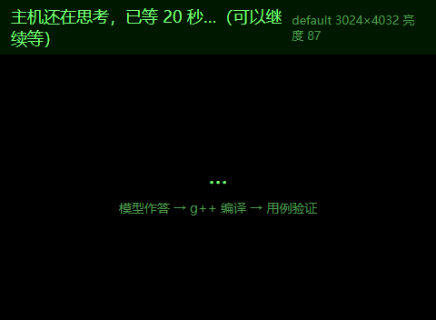
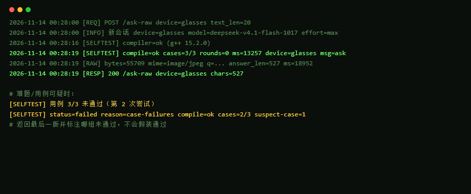
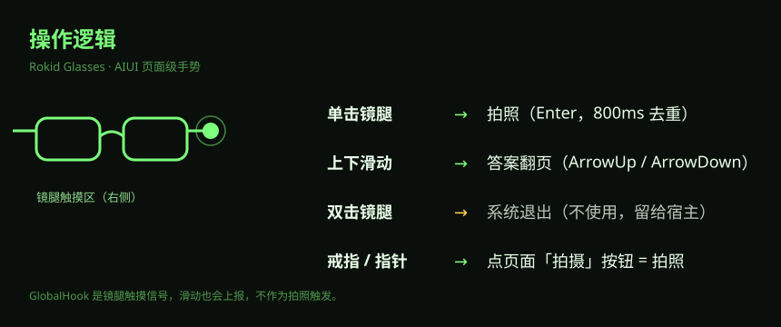

# rokid-glasses-coding-problem-agent

**[简体中文](README.zh-CN.md) | English**

**A coding-problem agent for Rokid Glasses: tap the temple to photograph a problem; a self-hosted bridge answers it, compiles the model's C++ with g++, runs test cases, and sends the verified answer back to the glasses.**

This is not "the model says it checked itself". The host actually compiles the generated C++ and runs test cases before returning the final answer.

---

## 1. What you need to replicate this

### Hardware

| Item | Notes |
|---|---|
| Rokid Glasses | Consumer edition paired with the Chinese Rokid AI app; no developer cable required |
| Windows host | Runs the bridge and WSL g++; a Linux host works if you replace the compile backend |
| Phone | Rokid AI app, used to update the glasses resource pack and launch the agent |

### Accounts & access

| Item | Notes |
|---|---|
| Rokid account | Must be able to sign in to [AIUI Studio](https://aiui.rokid.com); same account as the phone app |
| Model | A vision-capable model configured in DSH (example: DeepSeek V4.1 Flash; any OpenAI-compatible model works) |
| Public HTTPS endpoint | Domain + Caddy, or Cloudflare Tunnel; the glasses must reach your host over the internet |

### Software

| Item | Notes |
|---|---|
| Node.js | 20+ (DSH's bundled runtime also works) |
| DSH (DeepSeek Harness) | The server runs as a Host plugin; without DSH, implement a compatible service per `docs/protocol.md` |
| WSL + build-essential | `wsl g++ --version` must work; used for real compilation |
| AIUI Studio | Browser-based; no local Android toolchain needed |
| `aix` CLI (optional) | For command-line packaging/install: `npm i -g @yodaos-pkg/aix-cli` |

### Network

- The glasses need internet (phone hotspot or Bluetooth relay both work)
- The bridge listens on `127.0.0.1` only; expose it through Caddy or a tunnel
- For the 灵珠 SSE path (`/chat`), configure `flush_interval -1` on the reverse proxy

---

## 2. What to expect

### A full session

1. Say "open <your-agent>" on the glasses
2. A 640×480 low-bitrate viewfinder appears
3. Aim at the problem and **single-click the temple** → full-frame 3024×4032 photo
4. The photo is uploaded; the status line refreshes every 10 s ("host is still thinking, waited N s")
5. Host: model answers → extract C++ → `g++` compiles → run 3 test cases → feed failures back for a rewrite
6. The answer appears on the glasses, ending with "passed compile and N test cases"; swipe up/down to scroll

### Measured latency (Windows + WSL g++ 15.2 + DeepSeek V4.1 Flash, effort=max)

| Case | Latency | Result |
|---|---|---|
| Easy (sum, palindrome) | 15–25 s | compiles, 3/3 cases pass |
| Medium (LIS, edge cases) | 30–60 s | mostly 3/3; a suspicious case is flagged |
| Hard / suspicious cases | 1–3.5 min | one 90 s deep-debug escalation; returns the last version at the budget cap |
| Fallback | ≤ 4 min | glasses timeout 240 s; selftest budget 190 s |

### Expected / not expected

- ✅ Clear problem photo → answer is usually directly usable; plain-text C++, 4-space indent, Chinese comments
- ✅ Incomplete or blurry photo → the model asks for a retake instead of guessing
- ⚠️ Test cases are generated by the model; an occasional expected value is wrong (`suspect-case=1`). The answer is still returned, with the failing case named
- ⚠️ The current AIUI runtime has no `<camera>` component, and `enableSystemPreview` does not persist; the viewfinder is the app's own low-bitrate stream
- ⚠️ Do not request a 4K preview stream; it destabilizes the glasses runtime (this project uses 640×480)

---

## 3. Screens and interaction logic

> The screenshots below are drawn to the real 480×352 layout — colors, font sizes and button positions match the glasses UI. The on-device UI is Chinese.

### 1. Viewfinder


- Top 46% is a low-bitrate preview used for framing
- Status line: "aim at the problem, single-click the temple"; right side shows the preview resolution
- Bottom: gesture hint and a "拍摄" (shoot) button for the ring/pointer

### 2. Capture


- The preview stream is released immediately; the system camera takes the full-frame still
- Status line shows the mode, pixel size and average luma (black frames are rejected and retried)

### 3. Waiting for the host



- The status line refreshes every 10 s: "host is still thinking, waited N s… (you can keep waiting)"
- The counter is local to the glasses, so it keeps ticking even while the host is busy
- Maximum wait: 240 s; the host's selftest budget is 190 s

### 4. Answer and paging


- The status line keeps the source info: `来源：default 3024×4032 亮度 87`
- The answer area scrolls; **swipe up/down** to page, without triggering a capture
- "再拍一张" (shoot again) at the bottom returns to the viewfinder

### 5. Host selftest log



- `[SELFTEST] compile=ok cases=3/3` means the code was really compiled and three cases really ran
- Repeated case failures are marked `suspect-case=1`; the host returns the last version and names the failing case

### 6. Gesture map



| Input | Official event | Behavior |
|---|---|---|
| Single-click temple | `Enter` | capture (800 ms debounce) |
| Swipe up/down | `ArrowUp` / `ArrowDown` | scroll the answer |
| Ring/pointer button | `bindtap` | capture |
| Double-click temple | host system | exit (unused by this app) |
| Temple touch | `GlobalHook` | **not used for capture** (also emitted on swipes) |

---

## 4. How it works

```
Glasses (client/)
  640×480 viewfinder → single-click temple → wx CameraContext takes 3024×4032
  → raw JPEG bytes POST /ask-raw
        │ HTTPS (Caddy / tunnel)
Host (server/, DSH plugin)
  Bearer AK check → store image → DSH agent session (model answers)
  → extract C++ → wsl g++ compile → generate 3 cases and run them
  → feed failures back for a rewrite (optional one-shot agent deep debug)
  → return final version + "passed compile and N test cases"
```

- The glasses upload raw image bytes (no base64 on device: less memory, less traffic)
- The bridge binds loopback only; put HTTPS in front
- For the 灵珠 path, image URLs are downloaded and converted server-side, with SSRF guards

---

## 5. Repository layout

```
client/                Rokid AIUI agent (single-file .ink)
  config.js            ← set BRIDGE_URL / BRIDGE_AK before deploying
  pages/index/index.ink viewfinder, capture, upload, paging
server/                DSH Host plugin (Node, no third-party deps)
  index.js             HTTP server + sessions + image handling
  selftest.js          g++ compile + test-case verification
  cordis.patch.yml     DSH plugin mount config
docs/
  protocol.md          /ask-raw, /ask, /chat SSE
  deploy.md            deployment steps and acceptance checklist
  images/              UI mockups and gesture diagram
```

> Detailed protocol and deployment guides are currently in Chinese under `docs/`. Ask if you need English versions.

---

## 6. Quick start

1. **Client**: fill `client/config.js` → AIUI Studio → New agent → Local import `client/` → Device debug → fill the intent description → Repack and save
2. **Server**: put `server/` into the DSH local plugin directory → link it in the profile → add the plugin config in `cordis.patch.yml` (`accessKey`, `port`, `selftestForAsk: true`)
3. **Compiler**: install `build-essential` in WSL and verify `wsl g++ --version`
4. **Public entry**: Caddy `handle_path /rokid/* { reverse_proxy 127.0.0.1:8091 { flush_interval -1 } }`
5. **Glasses**: Rokid AI app → Settings → Developer → Update glasses resource pack → say "open <your-agent>"

See [docs/deploy.md](docs/deploy.md) for the full steps, config table, acceptance checklist and troubleshooting; see [docs/protocol.md](docs/protocol.md) for the wire format.

---

## License

MIT